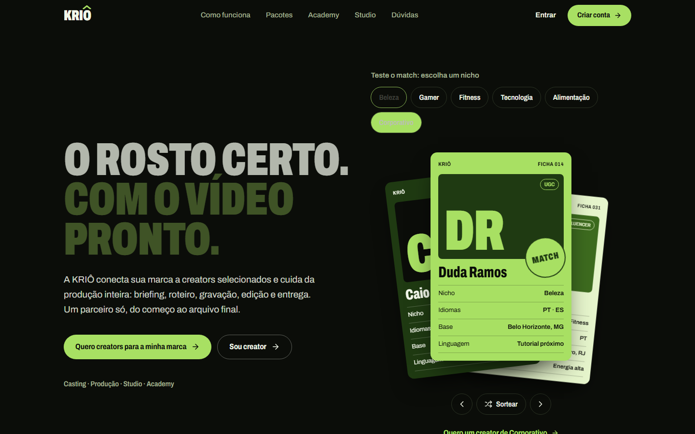
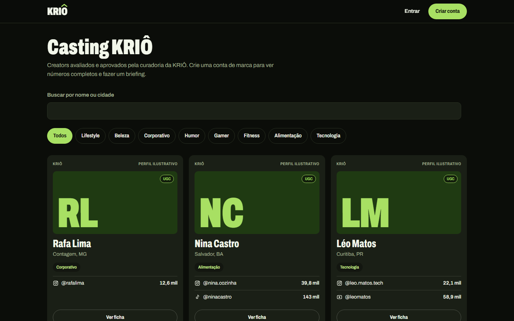

<div align="center">

# KRIÔ

**Site e plataforma de casting para uma creator company.**

Marcas mandam o briefing, a curadoria monta a lista curta, a marca passa as fichas
e, quando o creator aceita, dá **match** e abre a conversa entre os três.


<br/>



</div>

## Sobre

A KRIÔ conecta marcas a creators selecionados e cuida da produção inteira: briefing,
roteiro, gravação, edição e entrega. Construí o site institucional e a plataforma
onde esse fluxo acontece, do cadastro ao arquivo final, com front e back no mesmo repositório.

O coração do produto é o **baralho**: a marca recebe a lista curta montada pela curadoria
e passa as fichas dos creators, arrastando ou pelos botões. Quando a marca escolhe e o
creator aceita o convite, abre um chat em tempo real entre marca, creator e equipe.



## Funcionalidades

| Perfil | O que faz |
| --- | --- |
| **Marca** | Cria conta (e-mail ou Google), faz o briefing em 4 passos, passa as fichas da lista curta, conversa, aprova entregas ou pede ajuste (com contagem de rodadas) e favorita creators |
| **Creator** | Monta a ficha (foto, nichos, formatos, idiomas, vídeo), conecta Instagram, TikTok e YouTube pelo login oficial, envia para a curadoria, aceita convites e envia entregas |
| **Equipe** | Painel com indicadores, fila de avaliação de creators, quadro de pedidos por etapa, lista curta com sugestões automáticas e acesso a todas as conversas |
| **Visitante** | Site público, catálogo de creators com ficha resumida, termos e privacidade |

E por baixo:

- Chat com arquivos (imagem, vídeo, áudio, PDF) e avisos em tempo real
- E-mails transacionais de convite, match, lista pronta e aprovação
- Números das redes sociais atualizados todo dia
- Exclusão de conta (LGPD), tokens das redes cifrados, proteção contra CSRF e limite de tentativas de login

## Stack

| Camada | Ferramentas |
| --- | --- |
| Front-end | React, TypeScript, Vite, Tailwind CSS 4, Motion, Lucide |
| Back-end | Node.js com Hono, PostgreSQL com Drizzle ORM |
| Infra | Docker Compose, Caddy (HTTPS automático), backup diário; também roda na Vercel com Neon |
| Integrações | OAuth do Google, Instagram, TikTok e YouTube |

## Rodando localmente

Precisa do Node 22+.

```bash
git clone https://github.com/pablinrlq/krio.git
cd krio
npm install
npm run local
```

Abra <http://localhost:3000>. Na primeira vez o comando compila o site, cria um banco
embutido e as contas de demonstração (senha `krio2026`):

| Conta | Papel |
| --- | --- |
| `admin@krio.demo` | equipe KRIÔ |
| `marca@krio.demo` | marca com um pedido e a lista curta pronta |
| `duda@krio.demo` | creator no casting |
| `joana@krio.demo` | creator aguardando avaliação |

Para desenvolver com recarga automática: `npm run dev` (site em `:5173`, API em `:3000`).

Publicação em VPS ou na Vercel e configuração das redes sociais: [docs/IMPLANTACAO.md](docs/IMPLANTACAO.md).

## Estrutura

```
src/
├── components/   seções do site público
├── pages/        telas da plataforma (acesso, marca, creator, admin)
└── app/          chat e baralho
server/
├── routes/       API: contas, creators, redes, pedidos, chat, admin
├── db/schema.ts  tabelas (Drizzle)
└── social.ts     integrações com Instagram, TikTok e YouTube
```

## Decisões técnicas

- **Um servidor só.** Hono serve a API e o build do Vite na mesma porta, o que simplifica deploy e cookies de sessão.
- **Sem dependência obrigatória de terceiros.** Banco, arquivos e tempo real rodam no próprio servidor; na Vercel o mesmo código cai para polling e arquivos no banco.
- **Migrações automáticas** ao subir o container, então atualizar é `git pull` e `docker compose up -d --build`.

---

<div align="center">
<sub>Feito por <a href="https://github.com/pablinrlq">Pablo Moises</a> · as fichas e contas de demonstração são ilustrativas</sub>
</div>
